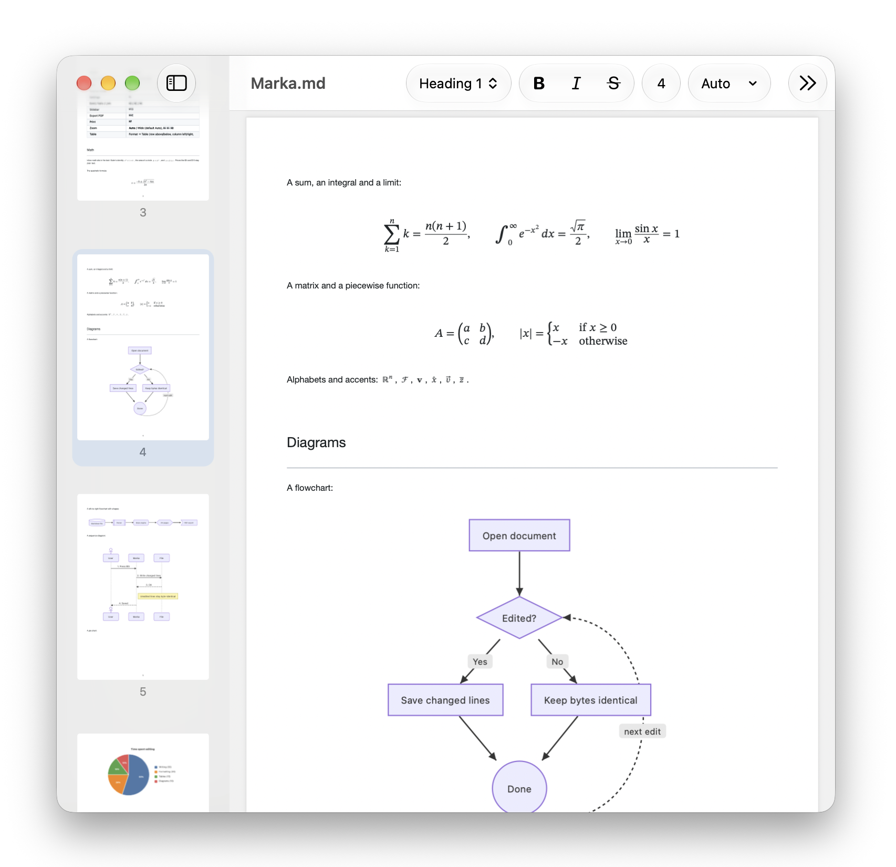

# Marka — a free, native WYSIWYG Markdown editor for Mac

**Marka** is a free, open-source Markdown editor for macOS. You write like in Word or Pages — no visible `**` or `#` — while the file stays clean GitHub-Flavored Markdown. Your document is laid out on real A4 pages, exactly as it will print or export to PDF.

Native Swift and AppKit: no Electron, no web view, a ~5 MB download.

[**⬇ Download Marka for macOS**](https://github.com/lubino/marka/releases/latest) · macOS 14 Sonoma or newer · Apple Silicon and Intel · MIT license



## Why Marka

- **WYSIWYG Markdown.** Formatting markers stay hidden while you write; `⌘/` shows the raw source any time.
- **Your file stays yours.** Saving never rewrites lines you did not touch, and an unedited file stays byte-for-byte identical — clean diffs in Git.
- **Pages you can print.** Live A4 pages with page breaks, thumbnails and page numbers; PDF export and print match the screen exactly, links included.
- **Math and diagrams without a browser.** LaTeX math (`$…$`, `$$…$$`) and Mermaid flowcharts, sequence diagrams and pie charts, typeset natively.
- **Tables that feel like Pages.** GitHub-style tables with in-place editing, drag-to-reorder rows and columns, and one-click insert or delete.
- **Publish to Git in one click.** When your document lives in a Git repository, **Publish** commits it — together with the other open documents of that repository — and pushes to `origin`.
- **A real Mac app.** Tabs, Liquid Glass on macOS 26, dark mode, the system share sheet, find and replace, and syntax-highlighted code in a ~5 MB app.

Looking for a **Typora alternative**, a native **Obsidian**-style editor for single files, or a modern successor to **MacDown**? Marka is free, open source and native.

On macOS 26 and later the window, sidebar, toolbar and icon use Liquid Glass; on macOS 14 and 15 Marka uses the classic translucent materials.

## Install

### 1. One-line installer (recommended)

Downloads the latest GitHub Release, verifies the SHA-256 checksum, installs `Marka.app` into `/Applications`, and launches it:

```bash
curl -fsSL https://raw.githubusercontent.com/lubino/marka/main/install.sh | bash
```

To update, run the same command again. To uninstall:

```bash
curl -fsSL https://raw.githubusercontent.com/lubino/marka/main/install.sh | bash -s -- --uninstall
```

### 2. Disk image from GitHub Releases

1. Download **`Marka.dmg`** from the **[latest release](https://github.com/lubino/marka/releases/latest)**.
2. Open the disk image and drag **Marka.app** into **Applications**.

Marka is open source and ad-hoc signed (no paid Apple Developer ID). If Gatekeeper blocks a browser download, choose **Open Anyway** in **System Settings → Privacy & Security**, or run:

```bash
xattr -cr /Applications/Marka.app && open /Applications/Marka.app
```

### 3. Zip from GitHub Releases

Download **`Marka-macos.zip`** from the same [releases page](https://github.com/lubino/marka/releases/latest), unzip it, and move `Marka.app` to Applications.

### 4. Build from source

Command Line Tools with Swift 6+ are enough (`xcode-select --install`). Full Xcode is not required:

```bash
curl -fsSL https://raw.githubusercontent.com/lubino/marka/main/install.sh | bash -s -- --from-source
```

Or clone and build locally:

```bash
git clone https://github.com/lubino/marka.git
cd marka
./scripts/build-app.sh
open build/Marka.app
```

## What you get

The saved file is ordinary UTF-8 GitHub-Flavored Markdown. Opening and saving without edits keeps the original bytes, including line endings.

**Writing**

- WYSIWYG Markdown: markers stay hidden while you write; source mode (`⌘/`) shows the raw Markdown.
- Headings (GitHub-style rule under Heading 1 and 2), bold, italic, strikethrough, lists, task lists, quotes, images, horizontal rules, and manual page breaks (`<!-- pagebreak -->`).
- The format toolbar also works inside links and while editing a table cell.
- **Text effects** (toolbar pull-down next to Strike, and the Format menu): underline, superscript, subscript and keyboard keys — written as GitHub-safe `<ins>`, `<sup>`, `<sub>`, `<kbd>`, shown formatted with the tags hidden. (Text colour and citations are not possible on GitHub, so Marka does not offer them.)
- **GitHub alerts**: `> [!NOTE]`, `[!TIP]`, `[!IMPORTANT]`, `[!WARNING]`, `[!CAUTION]` show with GitHub's coloured bar, icon and title (Insert → Note … Caution). Every quote gets GitHub's left bar.
- **Emoji**: Edit → Replace Emojis… (also the Emoji option in Find & Replace) steps through `:shortcodes:` and emoticons like `:)` and `<3` and replaces them with real emoji, one by one or all. Settings can also show `:shortcodes:` as emoji, like GitHub (off by default).
- Bold and italic can wrap links and inline code (`**[readme](README.md)**`, `**`Marka.dmg`**`); inline code gets GitHub's rounded box.
- Live format toolbar: controls highlight from the cursor, toggle off when already applied, and disable where a format cannot apply (fenced code, tables, …). The Code pull-down toggles inline code or inserts an empty fenced block (Text, Bash, Python, Swift, JSON).
- Search & replace popover from the toolbar search button (`⌘F` / `⌥⌘F`): match count, next/previous, Replace, Replace All, Match Case, Whole Words.
- Editing never makes the view jump, even when you change a code block's language.

**Links**

- Word-style links: only the blue label shows; a compact card shows the address with icon buttons — **Overview** (link to a heading or a file next to the document), **Choose File…** (point the link at a file on disk), **Open**, **Copy** and **Remove Link** (keeps the text). `⌘`-click opens.
- Links to headings use GitHub's anchors (`[Setup](#setup)`) and jump there; `notes.md#setup` opens the file. The toolbar's **Content** button (next to the page number, `⌘L`) and the page-number popover open the same overview for quick navigation to any heading or file.
- Images look like on GitHub: only the picture shows (no file name or Markdown), at its natural size but never wider than the page or taller than a page, in its own space — text never runs under it. A line of several images (badges) puts them side by side; an image inside a sentence appears below that line; web images load in the background; a missing image shows a small placeholder with its alt text. Images are in PDF export and print.
- Click an image for a card like the link card: its path or address, **Options** (gear: alt text, title, width and height in px or %, alignment), **Choose Image…**, **Open**, **Copy** (full path) and **Remove**. Size and alignment are saved as GitHub's `` (centred: `<p align="center">`); plain images stay ``.
- Images (toolbar, Format → Image…, drag and drop) and files chosen for a link: a file already inside the document's Git repository — or, without Git, its folder — is referenced with a relative path (and starts being tracked by Git). A file from elsewhere asks first: **copy** it next to the document (you can edit the name, images default to `assets/`) or **use the original location**, with a warning that such a reference breaks on other computers.
- Links to Markdown files open in a new Marka tab. A link to a Markdown file that does not exist yet creates it (empty) next to the document.

**Code**

- Fenced code is syntax-highlighted: bash, JSON, Python, JavaScript/TypeScript, C/C++, Swift, HTML, XML, CSS, YAML, Go, Rust, Java, Kotlin, Ruby, SQL, PHP.
- Small round glass Copy icon on code blocks and quotes; shell and Python blocks also get a Run-in-Terminal icon (Python runs with `python3` from the document's folder). The script just runs; Settings → "Run in Terminal: wait for a key press when the script ends" adds a ✓ / ✗ result line and waits for any key.

**Math and diagrams**

- Math in LaTeX syntax, typeset natively (no web view): inline `$e^{i\pi}+1=0$`, and display blocks with `$$ … $$` or a ```` ```math ```` fence. Supports fractions, roots, sub/superscripts, sums/integrals/limits, Greek letters and common symbols, `\left…\right`, matrices (`pmatrix`, `bmatrix`, …), `cases`, `aligned`, accents, `\text`, `\mathbf`, `\mathbb`, `\mathcal`. Unknown commands show in red.
- Mermaid diagrams in ```` ```mermaid ```` fences, drawn natively: flowcharts (`graph` / `flowchart`, all directions, common node shapes, labelled solid / dotted / thick links), sequence diagrams (participants, actors, messages, notes) and pie charts. Other Mermaid diagram types show a notice instead of a drawing.
- The **Insert** menu opens a gallery of ready-made examples at the cursor — Table, Image…, Code Block, Equation, Matrix, Flowchart, Left-to-right flow, Sequence Diagram and Pie chart — drawn exactly as they will appear; one click inserts it.
- Click a drawn equation or diagram to edit its source with a live preview. Place the cursor in inline math to edit it in place. Drawings move to the next page rather than crossing a page break, and appear in PDF export and print.

**Tables**

- Tables look like GitHub's. Insert one from the toolbar's Table gallery (Basic, Two Columns, Wide, Compact, Tall, Grid).
- Cells hold inline Markdown (bold, italic, `code`, links) and are edited WYSIWYG, like the rest of the document. Arrow keys, Tab and Return move between cells; Tab / Return add a row at the end.
- With the cursor in a cell, a blue grip appears beside its row and above its column: drag it to move the row or column, use the green **+** on either side to insert one there, or the red **−** to delete it. The same commands are in Format → Table and the cell's right-click menu.
- Long tables continue on the next page with the header repeated.
- Column alignment (`:---`, `:---:`, `---:`) is shown and set from Format → Table → Align Column Left / Center / Right; `\|` puts a pipe inside a cell (typed pipes are escaped for you) — exactly what GitHub tables support.

**Pages, export, print**

- Live A4 pages; what you see is what PDF and print produce. Pages follow the content — no empty last page.
- Export PDF (`⇧⌘E`) keeps links clickable. File → Print… (`⌘P`) and the toolbar Print button open the standard print dialog.
- Share the document's `.md` file with the standard macOS share button or File → Share.

**Git: Publish**

- When the open document is tracked by Git, the toolbar **Publish** button (and File → Publish…) is enabled. It saves the open documents, then shows a popover with tabs: **Message** (a suggested commit message), **Files** (every changed file of the open documents in that repository, with added / removed line counts), **Diff** (coloured per file — click a file to see it) and **History** (the last three commits, who made them and when).
- **Publish** (`⌘↩`) commits exactly those files — other work you staged elsewhere stays staged — and pushes to `origin` (setting the upstream on the first push). Without an `origin` remote it only commits.
- If the commit or push fails, Marka says so and leaves the fix to your usual Git tool; **Show more** shows Git's output. A failed push keeps the commit.
- When you open a tracked file, Marka checks in the background whether someone published a newer version of it. If so, it asks whether to update (Settings → Git can update automatically instead). Updating fast-forwards your copy like `git pull --ff-only`; if that is not possible — unpublished commits of your own, or conflicting edits — Marka leaves everything as it was and explains why.
- Files your documents link to or show as images (`[notes](notes/plan.md)`, ``) that are inside the repository but not tracked yet are added to Git when you click Publish, so they are listed as **Added** and published together with the document.
- New files Marka creates inside a repository are added to Git right away: documents saved for the first time, Markdown files created from a link, and images dropped into `assets/` (ignored paths stay ignored).
- Marka uses the `git` you already have (Command Line Tools or Homebrew) with your existing credentials and never asks for passwords. Settings → Git turns the feature off; it is unavailable when Git is not installed.

**Window**

- Preview-style window: full-height thumbnail sidebar with the window controls on it, the document scrolling under a translucent toolbar, Liquid Glass on macOS 26+.
- New documents open as tabs; the tab bar appears once two or more tabs are open.
- Remembers its window position and size; documents open at the top, and zooming keeps your place.
- Zoom pull-down with 25–400 % presets and Auto (fits the page to the window).
- The toolbar shows the current page number. Click it (or View → Go to Page…, `⌥⌘G`) to jump to a page and see word, character, selection and reading-time counts, structure counts, a word-goal progress bar, encoding, line endings, file size, and the file path.
- Settings (`⌘,`): default font and size (Times New Roman 10 pt), margins, page numbers, autosave, auto-load, dark paper, word goal, page number in the toolbar, emoji shortcodes, wait after scripts, Git (Publish, check for newer published versions, update automatically).
- Autosave writes your edits to the file as you work (turn it off to save only with `⌘S`). Auto-load does the opposite: when another app, an AI agent or `git pull` changes the file, the open document updates in place without moving the view; if you also have unsaved edits, Marka asks which version to keep.
- Light/dark UI (paper stays white unless you enable dark paper). Crash logs go to `~/Library/Logs/Marka`, and the next launch offers to show the latest report.

## Command line: Markdown → PDF

Marka can export a Markdown file to PDF from Terminal — same pages and fonts as the app, no window — and prints the counts from the Page popover:

```bash
/Applications/Marka.app/Contents/MacOS/Marka -pdf README.md README.pdf
```

```text
Exported /Users/you/project/README.pdf

Pages           6
Words           745
Reading time    4 min
…
```

Full guide: [cli.md](cli.md). The output name is optional (default: the input with `.pdf`). Exit code 0 = exported, 1 = error, 2 = wrong arguments. For a shorter command: `alias marka=/Applications/Marka.app/Contents/MacOS/Marka`.

## Shortcuts

| Action                        | Shortcut                                  |
| ----------------------------- | ----------------------------------------- |
| Undo / Redo                   | `⌘Z` or `⌃Z` / `⇧⌘Z`                      |
| Bold / Italic / Underline     | `⌘B` / `⌘I` / `⌘U`                        |
| Link                          | `⌘K`                                      |
| Heading 1 / 2 / 3             | `⌥⌘1` / `⌥⌘2` / `⌥⌘3`                     |
| Find / Find and Replace       | `⌘F` / `⌥⌘F`                              |
| Find Next / Previous          | `⌘G` / `⇧⌘G`                              |
| Go to Page                    | `⌥⌘G`                                     |
| Go to Content (headings, files) | `⌘L`                                    |
| Source mode                   | `⌘/`                                      |
| Thumbnails sidebar            | `⌥⌘S`                                     |
| Zoom in / out / actual size   | `⌘+` / `⌘-` / `⌘0`                        |
| Export PDF / Print            | `⇧⌘E` / `⌘P`                              |
| Settings                      | `⌘,`                                      |
| Table rows and columns        | Format → Table, or the grips in a table   |

New to Marka? Read the [Help](Help.md) (also Help → Marka Help in the app) and the full list of [keyboard shortcuts](Shortcuts.md) (Help → Keyboard Shortcuts).

## License

[MIT](./LICENSE)
