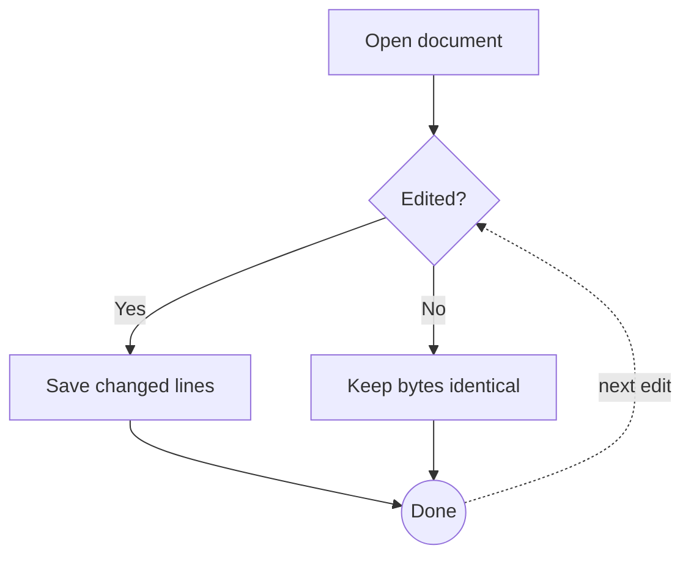
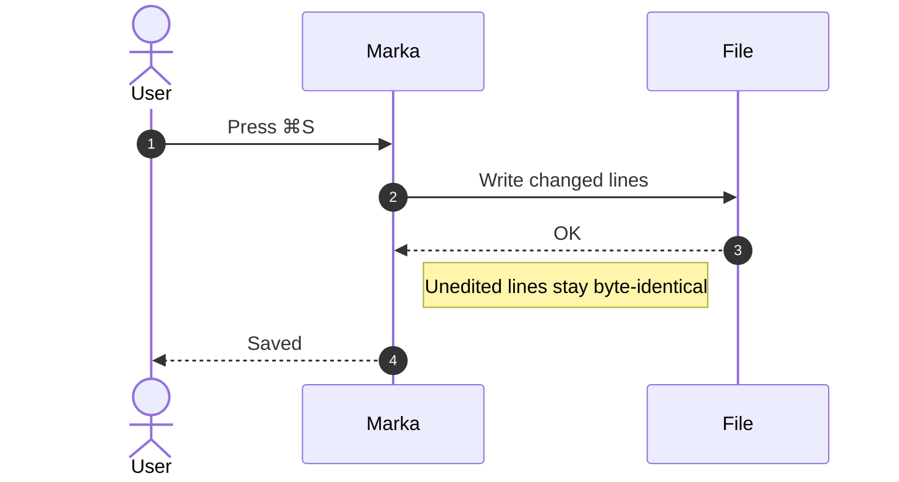
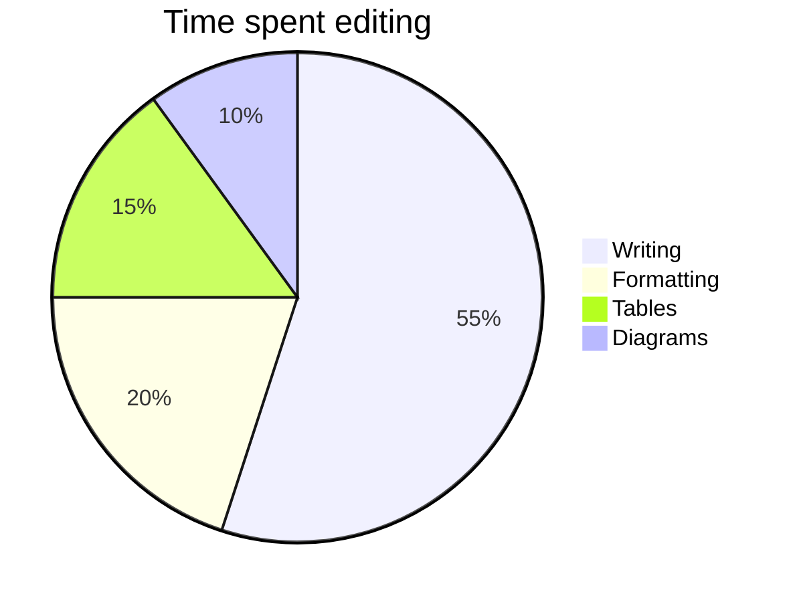

# Marka Test file

Native macOS Markdown editor with a live A4 page preview.

```bash
pwd
echo "hello there"
```

```java
@FieldDefaults(level = AccessLevel.PRIVATE)
public class SomeDTO {
    @Id
    String id;
}
```

```json
{
  "f1String": "Kaaamo",
  "f2Object": {
    "Num": 1,
    "arr": ["String"]
  }
}
```

```yaml
Test:
  field: 1
  arr:
    - 1
    - 2
    - subtype:
      ahoj: 1
```

1. Download **`Marka.dmg`** from the **[latest release](https://github.com/lubino/marka/releases/latest)**.
2. Other file **[readme](README.md)**

### 3. Zip from GitHub Releases

Download **`Marka-macos.zip`** from the same [releases page](https://github.com/lubino/marka/releases/latest), unzip it, and move `Marka.app` to Applications.

- WYSIWYG Markdown (markers stay hidden; source mode `⌘/` shows raw Markdown)
- Live A4 pages with thumbnail sidebar (white page chips, no grey frame)
- Headings, emphasis, lists, task lists, quotes, images
- Word-style links: blue display text (including `[`file.md`](./file.md)`), URL card (Open / Copy / Remove). Local Markdown opens in Marka; other URLs open in the system app
- GitHub-style fenced code and quotes: overlapping-squares copy chip hanging off the top-right corner. Shell fences also get a Terminal chip that runs the block in Terminal.app
- Pages-style tables: size grid on insert, empty cells, A/B/C column letters and row numbers, green + to add and red − to delete (select a row or column first). Last row/column removes the table. Long tables split across pages with a repeated header. WYSIWYG never shows the raw `|` pipes.
- Crash logs in `~/Library/Logs/Marka`; the next launch offers to show the latest report
- Live format toolbar: Bold, headings, and other controls highlight from the caret and toggle off when already applied. The Code control is a popup (Inline / Text / Bash / Python / Swift / JSON) that inserts an empty fenced block with the caret inside, or toggles inline backticks. Controls disable in fenced code, a Pages table, and other places where that format cannot apply
- Compact headings and paragraphs; GitHub-style underline under Heading 1 and 2 (the rule is not a typeable line)
- Preview-style chrome: translucent titlebar, sidebar button next to the window controls, thumbnail pane below the titlebar, rounded window tabs, light gray-blue selected page. Zoom is − / Auto / + magnifiers. Zoomed-out pages stay centered.
- Settings (`⌘,`): default font and size (Times New Roman 10 pt), margins, page numbers, autosave, dark paper
- Manual page break: `<!-- pagebreak -->`**
- Export PDF (`⌘⇧E`) and print (`⌘P`) using the same pages
- Share the `.md` file or a generated PDF
- Autosave, find & replace, zoom, light/dark UI (paper stays white unless you enable dark paper)

The saved file is ordinary UTF-8 GitHub-Flavored Markdown. Opening and saving without edits keeps the original bytes, including line endings.

## Table


| Action               | Shortcut                                                    |
| -------------------- | ----------------------------------------------------------- |
| Undo / Redo          | `⌘Z` or `Ctrl+Z` / `⌘⇧Z`                                    |
| Find                 | `⌘F`                                                        |
| Source mode          | `⌘/`                                                        |
| Settings             | `⌘,`                                                        |
| Bold / Italic / Link | `⌘B` / **`⌘I`** / `⌘K`                                      |
| Sidebar              | `⌘⌥S`                                                       |
| Export PDF           | `⌘⇧E`                                                       |
| Print                | `⌘P`                                                        |
| Zoom                 | **Auto** / *Wide* (default Auto), `⌘+` `⌘-` `⌘0`            |
| Table                | Format → Table (row above/below, column left/right, delete) |

## Math

Inline math sits in the text: Euler's identity $e^{i\pi} + 1 = 0$, the area of a circle $A = \pi r^2$, and $\alpha + \beta \le \gamma$. Prices like $5 and $10 stay plain text.

The quadratic formula:

$$
x = \frac{-b \pm \sqrt{b^2 - 4ac}}{2a}
$$

A sum, an integral and a limit:

```math
\sum_{k=1}^{n} k = \frac{n(n+1)}{2}, \qquad \int_0^\infty e^{-x^2}\,dx = \frac{\sqrt{\pi}}{2}, \qquad \lim_{x \to 0} \frac{\sin x}{x} = 1
```

A matrix and a piecewise function:

$$
A = \begin{pmatrix} a & b \\ c & d \end{pmatrix}, \qquad |x| = \begin{cases} x & \text{if } x \ge 0 \\ -x & \text{otherwise} \end{cases}
$$

Alphabets and accents: $\mathbb{R}^n$, $\mathcal{F}$, $\mathbf{v}$, $\hat{x}$, $\vec{v}$, $\overline{z}$.


## Diagrams

A flowchart:


A left-to-right flowchart with shapes:

```mermaid
flowchart LR
  md[(Markdown file)] --> parse[[Parser]] --> style(Style engine) --> pages{{A4 pages}}
  pages ==> pdf>PDF export]
```

A sequence diagram:



A pie chart:


