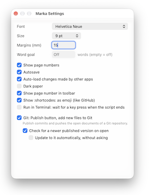
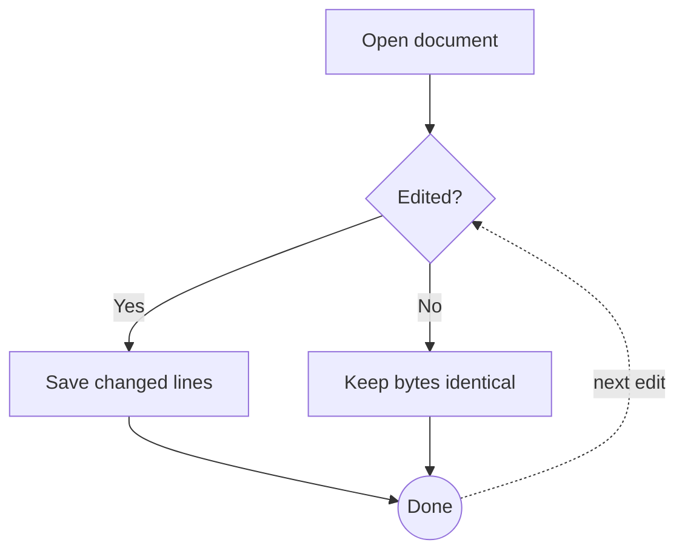
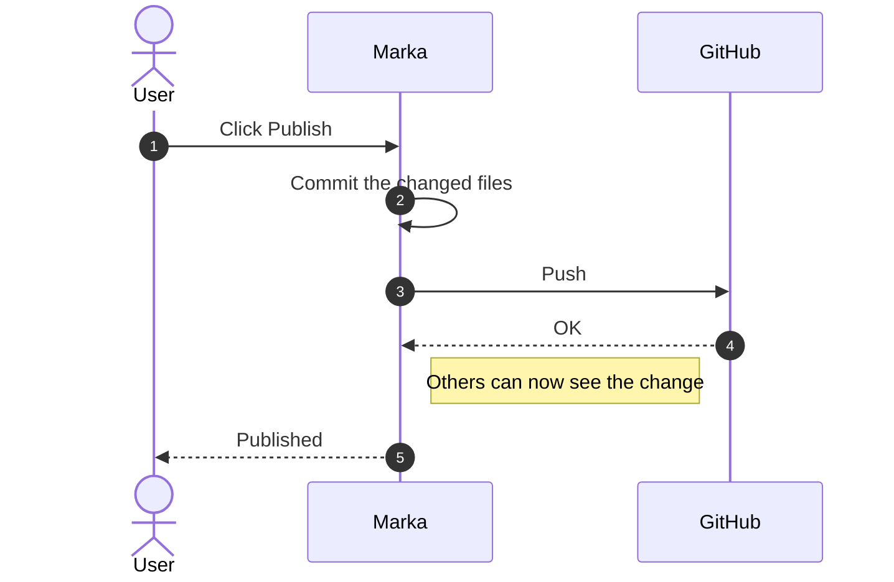
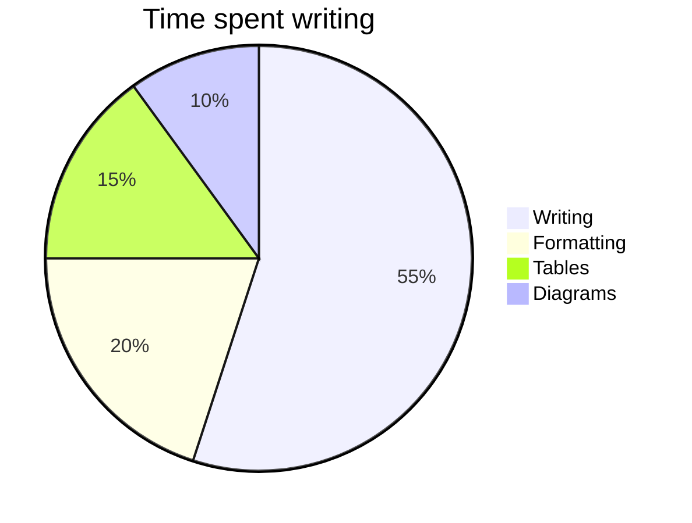

# Welcome to Marka

This file is a **hands-on tour**. Everything you read here is a real Markdown feature, so you can click it, change it and see what happens. Nothing breaks: <kbd>⌘</kbd> <kbd>Z</kbd> takes back any change.

> [!TIP]
> Press <kbd>⌘</kbd> <kbd>/</kbd> at any time to see the **Markdown source** behind what you see (the "recipe"). Press it again to go back.

**The toolbar** at the top of the window:

| Icon | Button | What it does |
| :---: | --- | --- |
|  | **Thumbnails** | Shows or hides the page thumbnails on the left |
|  | **Text effects** | Underline, superscript, subscript, keyboard keys |
|  | **Code** | Inline code, or a new code block |
|  | **Table** | A gallery of table shapes |
|  | **Image** | Insert a picture |
|  | **Content** | Jump to a heading or a file (<kbd>⌘</kbd> <kbd>L</kbd>) |
|  | **Find** | Find and replace (<kbd>⌘</kbd> <kbd>F</kbd>) |
|  | **Share** | Send this file by AirDrop, Mail, Messages… |
|  | **Publish** | Save your changes to Git (in a Git repository) |
|  | **Print** | Print the pages (<kbd>⌘</kbd> <kbd>P</kbd>) |
|  | **PDF** | Export a PDF (<kbd>⇧</kbd> <kbd>⌘</kbd> <kbd>E</kbd>) |

**Contents** — click a line, or press <kbd>⌘</kbd> <kbd>L</kbd> for the Content list:

1. [Code blocks](#1-code-blocks)
2. [Settings](#2-settings)
3. [Writing and formatting](#3-writing-and-formatting)
4. [Links](#4-links)
5. [Pictures](#5-pictures)
6. [Tables](#6-tables)
7. [Notes and warnings](#7-notes-and-warnings)
8. [Math with LaTeX](#8-math-with-latex)
9. [Diagrams with Mermaid](#9-diagrams-with-mermaid)
10. [Emoji](#10-emoji)
11. [Find and replace](#11-find-and-replace)
12. [Git and Publish](#12-git-and-publish)
13. [When other apps change a file](#13-when-other-apps-change-a-file)
14. [Pages, PDF and printing](#14-pages-pdf-and-printing)
15. [PDF from Terminal](#15-pdf-from-terminal)
16. [Keyboard shortcuts](#16-keyboard-shortcuts)

## 1. Code blocks

A code block is text between two lines of three backticks. The word after the first backticks names the language, and Marka **colours** the code like a programming editor.

Every code block has small round icons at its top-right corner:

| Icon | Name | What it does |
| :---: | --- | --- |
|  | **Copy** | Copies the code (without the backticks). A ✔ shows for a moment. |
|  | **Run in Terminal** | Only on `bash` / `sh` / `zsh` and `python` blocks: runs the code in Terminal, in the folder of this file. |

### Try it: run a script

Move the pointer over the block below and click its **Run in Terminal** icon. Terminal opens and shows today's date, your macOS version and the files next to this document.

```bash
echo "Hello from Marka 👋"
date
sw_vers -productVersion
ls -la
```

Python works the same way. This one even asks you a question — type an answer in Terminal:

```python
name = input("What is your name? ")
print(f"Nice to meet you, {name}!")

# Fibonacci numbers
a, b = 0, 1
for _ in range(12):
    print(a, end=" ")
    a, b = b, a + b
print()
```

> [!NOTE]
> Terminal keeps the window open with the output. If you prefer a **✓ Finished / ✗ Exited with code …** line and a "Press any key" prompt at the end, switch on *Run in Terminal: wait for a key press when the script ends* in Settings.

### Make your own

- Toolbar **Code** button (the `{ }` icon): *Inline Code*, or an empty block for Text, Bash, Python, Swift or JSON. The cursor lands inside.
- **Insert → Code Block** shows a gallery of languages.
- Or type three backticks and a language name yourself.

Inline code sits in a sentence: open `~/Library/Logs/Marka` or run `git status`.

### Colours for many languages

```swift
struct Note: Identifiable {
    let id = UUID()
    var title: String
    var done = false
}
let notes = [Note(title: "Try Marka"), Note(title: "Publish", done: true)]
print(notes.filter { !$0.done }.map(\.title))
```

```javascript
// Count the words in a text
const words = (text) => text.trim().split(/\s+/).filter(Boolean).length;
console.log(`Words: ${words("Marka is a native Markdown editor")}`);
```

```typescript
interface Page { number: number; words: number }
const total = (pages: Page[]): number => pages.reduce((sum, p) => sum + p.words, 0);
```

```json
{
  "name": "Marka",
  "native": true,
  "formats": ["md", "pdf"],
  "version": { "major": 1, "minor": 1 }
}
```

```yaml
app: Marka
features:
  - code blocks
  - tables
  - diagrams
pdf:
  paper: A4
  margins: 20 # millimetres
```

```sql
SELECT title, COUNT(*) AS edits
FROM documents
WHERE updated_at > '2026-01-01'
GROUP BY title
ORDER BY edits DESC;
```

```html
<article class="note">
  <h1>Hello</h1>
  <p>Written in <strong>Marka</strong>.</p>
</article>
```

```css
.note h1 {
  color: #505e76;
  font: bold 2rem/1.2 "Arial", sans-serif;
}
```

```go
package main

import "fmt"

func main() {
	fmt.Println("Hello from Go")
}
```

```rust
fn main() {
    let pages = vec![12, 8, 15];
    let total: i32 = pages.iter().sum();
    println!("Total: {total}");
}
```

```java
public record Document(String title, int pages) {
    public boolean isLong() { return pages > 10; }
}
```

```kotlin
data class Task(val title: String, val done: Boolean = false)
val open = listOf(Task("Write"), Task("Publish", true)).filterNot { it.done }
```

```ruby
notes = %w[write review publish]
notes.each_with_index { |note, i| puts "#{i + 1}. #{note}" }
```

```php
<?php
$name = "Marka";
echo "Hello from $name\n";
```

```c
#include <stdio.h>

int main(void) {
    printf("Pages: %d\n", 42);
    return 0;
}
```

```xml
<plist version="1.0">
  <dict>
    <key>CFBundleName</key>
    <string>Marka</string>
  </dict>
</plist>
```

## 2. Settings

Open Settings with <kbd>⌘</kbd> <kbd>,</kbd> (or **Marka → Settings…**). Changes apply right away.



| Setting | What it changes |
| --- | --- |
| **Font** and **Size** | The text font of every document (default Times New Roman 10 pt) |
| **Margins (mm)** | Page margins of the A4 pages, PDF and print |
| **Word goal** | Shows progress towards a word count in the Page popover |
| **Show page numbers** | Numbers at the bottom of every page |
| **Autosave** | Saves while you work. Off: save with <kbd>⌘</kbd> <kbd>S</kbd> |
| **Auto-load** | Shows changes other apps make to the file ([section 13](#13-when-other-apps-change-a-file)) |
| **Dark paper** | Dark pages instead of white ones |
| **Show page number in toolbar** | The page number button in the window's toolbar |
| **Show :shortcodes: as emoji** | Shows `:rocket:` as 🚀, like GitHub ([section 10](#10-emoji)) |
| **Run in Terminal: wait…** | Result line and key prompt after a script ([section 1](#1-code-blocks)) |
| **Git** | The Publish button, adding new files to Git, checking for newer versions ([section 12](#12-git-and-publish)) |

## 3. Writing and formatting

Select some words, then click a toolbar button — or use the shortcut:

- **Bold** with <kbd>⌘</kbd> <kbd>B</kbd>, *italic* with <kbd>⌘</kbd> <kbd>I</kbd>, ~~strikethrough~~ with the **S** button.
- **Text effects** — the button next to **S**: <ins>underline</ins> (<kbd>⌘</kbd> <kbd>U</kbd>), superscript like E = mc<sup>2</sup>, subscript like H<sub>2</sub>O and keyboard keys like <kbd>⌘</kbd> <kbd>K</kbd>.
- You can mix them: ***bold and italic***, **bold with `code`**, *italic [link](#3-writing-and-formatting)*.
- Click a button again to remove the formatting.

### Headings

The **Heading** menu in the toolbar (or <kbd>⌥</kbd> <kbd>⌘</kbd> <kbd>1</kbd> / <kbd>2</kbd> / <kbd>3</kbd>) turns a line into a heading. Heading 1 and 2 get a line underneath, like on GitHub.

#### A level-4 heading

##### A level-5 heading

###### A level-6 heading

### Lists

Use the **List** button in the toolbar (bulleted, numbered or task list) — it works on every selected line at once. Press <kbd>↩</kbd> for the next item and <kbd>↩</kbd> on an empty item to end the list. <kbd>Tab</kbd> moves an item in, <kbd>⇧</kbd> <kbd>Tab</kbd> moves it back. <kbd>⌫</kbd> at the start of an item moves a nested item out one level, then turns it into normal text.

- Groceries
    - Apples
    - Coffee
        - Beans, not ground
- Books

1. Open Marka
2. Write something
3. Press <kbd>⇧</kbd> <kbd>⌘</kbd> <kbd>E</kbd> for a PDF

### Task lists

Click a checkbox to tick a task off — click again to untick it. Done tasks turn grey, so open ones stand out. <kbd>↩</kbd> after a ticked task starts a new, unticked one. In the file it is `- [x]` or `- [ ]`:

- [x] Read the welcome
- [x] Try a code block
- [ ] Insert a table
- [ ] Draw a diagram
- [ ] Publish with Git

### Quotes

> Simplicity is the ultimate sophistication.
>
> — often attributed to Leonardo da Vinci

Make one with the **Quote** button in the toolbar (it quotes every selected line; click again to unquote). <kbd>⌫</kbd> at the start of a quoted line removes the quote. Every quote has a **Copy** icon, just like code blocks.

> Quotes can hold lists too:
>
> - [x] Lists inside quotes get bullets
> - [ ] And checkboxes you can click

### A dividing line

Three dashes on their own line:

---

## 4. Links

A link is a word you can click to go somewhere: [the Marka website](https://github.com/lubino/marka), [the README](../README.md), or a heading of this document like [Tables](#6-tables).

**Try it:** click on a link. A small card appears below it with the address and these icons:

| Icon | What it does |
| :---: | --- |
|  | **Content** — link to a heading of this document or a file next to it |
|  | **Choose File…** — link to any file on your Mac |
|  | **Open** the link (<kbd>⌘</kbd>-click works too) |
|  | **Copy** the address |
|  | **Remove** the link, keep the words |

Make a link: select a word and press <kbd>⌘</kbd> <kbd>K</kbd>, then type the address in the card.

**How addresses work:**

- `https://…` is a website: [apple.com](https://www.apple.com).
- Anything else is a file **next to this document**, as if it started with `./`: [the Help guide](Help.md), [all shortcuts](Shortcuts.md), [command line](cli.md).
- `#` jumps to a heading here: [back to the top](#welcome-to-marka).
- A link to a `.md` file that does not exist yet creates it when you open it: [my-new-note.md](my-new-note.md).

## 5. Pictures

Drag a picture onto the page, or use **Insert → Image…**. Marka shows the picture itself — the file name stays hidden, and the picture gets its own space on the page.

**Try it:** click the Settings picture in [section 2](#2-settings). A card appears:

| Icon | What it does |
| :---: | --- |
|  | **Options** — size (pixels or %), alignment, description and title |
|  | **Choose Image…** — use a different picture |
|  | **Open** the picture in Preview |
|  | **Copy** its full path |
|  | **Remove** the picture |

The same picture, smaller and centred (made with **Options**):

<p align="center"></p>

A picture that is missing shows a placeholder with its description:


> [!IMPORTANT]
> When you add a picture from **outside** this document's folder (or Git repository), Marka asks: **Copy Image** puts a copy next to the document (in `assets/`), **Use Original Location** only links to it — and then it works only on this Mac.

## 6. Tables

Tables look like on GitHub. **Make one:** the **Table** button in the toolbar shows ready-made shapes.

| Feature | Supported | Notes |
| :--- | :---: | ---: |
| **Bold**, *italic*, `code` | ✅ | in any cell |
| Links like [Help](Help.md) | ✅ | click to open |
| A pipe \| inside a cell | ✅ | written as `\|` |
| Pictures | ✅ |  |
| Column alignment | ✅ | left · centre · right |

**Try it:**

- Click a cell and type. <kbd>Tab</kbd> goes to the next cell, <kbd>↩</kbd> to the cell below; at the end they add a row.
- While you are in a cell, a blue handle appears next to its row and above its column: **drag** it to move the row or column. Click a green **+** to add one, a red **−** to delete one.
- **Format → Table → Align Column Left / Center / Right** lines up a column.
- Long tables continue on the next page, with the header row repeated.

| Planet | Moons | Distance from the Sun |
| --- | ---: | ---: |
| Mercury | 0 | 0.39 AU |
| Venus | 0 | 0.72 AU |
| Earth | 1 | 1.00 AU |
| Mars | 2 | 1.52 AU |
| Jupiter | 95 | 5.20 AU |
| Saturn | 146 | 9.58 AU |

## 7. Notes and warnings

GitHub calls these *alerts*. Make one with **Insert → Note, Tip, Important, Warning or Caution**.

> [!NOTE]
> Useful information that readers should know, even when skimming.

> [!TIP]
> Helpful advice for doing things better or more easily.

> [!IMPORTANT]
> Key information readers need to achieve their goal.

> [!WARNING]
> Urgent information that needs immediate attention to avoid problems.

> [!CAUTION]
> Advises about risks or negative outcomes of certain actions.

This is how a note looks in Markdown:

```text
> [!NOTE]
> Useful information that readers should know, even when skimming.
```

## 8. Math with LaTeX

Marka draws math formulas written in **LaTeX** — no internet, no browser. **Insert → Equation** and **Insert → Matrix** show ready-made examples. **Click a formula** to edit it, with a live preview; <kbd>⌘</kbd> <kbd>↩</kbd> applies.

### Math inside a sentence
Write it between single dollar signs. You type:

```text
Euler's identity $e^{i\pi} + 1 = 0$ and the area of a circle $A = \pi r^2$.
```

You get: 
Euler's identity $e^{i\pi} + 1 = 0$ and the area of a circle $A = \pi r^2$. Put the cursor inside a formula to edit it right there. Prices like $5 and $10 stay normal text.

### Formulas on their own line

Use two dollar signs, or a `math` code block. You type:

```text
$$
x = \frac{-b \pm \sqrt{b^2 - 4ac}}{2a}
$$
```

You get:

$$
x = \frac{-b \pm \sqrt{b^2 - 4ac}}{2a}
$$

### Sums, integrals and limits

```text
\sum_{k=1}^{n} k = \frac{n(n+1)}{2}, \qquad \int_0^\infty e^{-x^2}\,dx = \frac{\sqrt{\pi}}{2}, \qquad \lim_{x \to 0} \frac{\sin x}{x} = 1
```

```math
\sum_{k=1}^{n} k = \frac{n(n+1)}{2}, \qquad \int_0^\infty e^{-x^2}\,dx = \frac{\sqrt{\pi}}{2}, \qquad \lim_{x \to 0} \frac{\sin x}{x} = 1
```

### Matrices and cases

```text
A = \begin{pmatrix} a & b \\ c & d \end{pmatrix}, \qquad \det A = \begin{vmatrix} a & b \\ c & d \end{vmatrix} = ad - bc
```

```math
A = \begin{pmatrix} a & b \\ c & d \end{pmatrix}, \qquad \det A = \begin{vmatrix} a & b \\ c & d \end{vmatrix} = ad - bc
```

```text
|x| = \begin{cases} x & \text{if } x \ge 0 \\ -x & \text{otherwise} \end{cases}
```

```math
|x| = \begin{cases} x & \text{if } x \ge 0 \\ -x & \text{otherwise} \end{cases}
```

### Greek letters, alphabets and accents

```text
\alpha, \beta, \gamma, \Delta, \pi, \Omega \quad \mathbb{R}^n, \mathcal{F}, \mathbf{v} \quad \hat{x}, \vec{v}, \overline{z}
```

```math
\alpha, \beta, \gamma, \Delta, \pi, \Omega \quad \mathbb{R}^n, \mathcal{F}, \mathbf{v} \quad \hat{x}, \vec{v}, \overline{z}
```

### Physics and statistics

```text
E = mc^2, \qquad F = G\frac{m_1 m_2}{r^2}, \qquad \bar{x} = \frac{1}{n}\sum_{i=1}^{n} x_i, \qquad \sigma = \sqrt{\frac{1}{n}\sum_{i=1}^{n}(x_i - \bar{x})^2}
```

```math
E = mc^2, \qquad F = G\frac{m_1 m_2}{r^2}, \qquad \bar{x} = \frac{1}{n}\sum_{i=1}^{n} x_i, \qquad \sigma = \sqrt{\frac{1}{n}\sum_{i=1}^{n}(x_i - \bar{x})^2}
```

A command Marka does not know is shown in red, so typos are easy to spot:

```math
a + \unknowncommand{b}
```

## 9. Diagrams with Mermaid

Marka draws **Mermaid** diagrams from a few lines of text. **Insert → Flowchart, Left-to-right flow, Sequence Diagram or Pie chart** show examples. **Click a diagram** to edit its text with a live preview.

### A flowchart

You type:

```text
graph TD
  A[Open document] --> B{Edited?}
  B -->|Yes| C[Save changed lines]
  B -->|No| D[Keep bytes identical]
  C --> E((Done))
  D --> E
  E -.->|next edit| B
```

You get:



### Left to right, with every shape

```text
flowchart LR
  md[(Markdown file)] --> parse[[Parser]] --> style(Style engine) --> pages{{A4 pages}}
  pages ==> pdf>PDF export]
```

```mermaid
flowchart LR
  md[(Markdown file)] --> parse[[Parser]] --> style(Style engine) --> pages{{A4 pages}}
  pages ==> pdf>PDF export]
```

### A sequence diagram

```text
sequenceDiagram
  autonumber
  actor User
  participant M as Marka
  participant G as GitHub
  User->>M: Click Publish
  M->>M: Commit the changed files
  M->>G: Push
  G-->>M: OK
  Note right of M: Others can now see the change
  M-->>User: Published
```



### A pie chart

```text
pie title Time spent writing
  "Writing" : 55
  "Formatting" : 20
  "Tables" : 15
  "Diagrams" : 10
```



Other Mermaid diagram types show a short notice instead of a drawing:

```mermaid
gantt
  title Not drawn by Marka (yet)
```

## 10. Emoji

You can type emoji directly 🎉 — <kbd>⌃</kbd> <kbd>⌘</kbd> <kbd>Space</kbd> opens the macOS emoji picker.

GitHub also understands **shortcodes** like `:rocket:`, `:white_check_mark:` or `:warning:`. Turn on *Show :shortcodes: as emoji* in Settings and these turn into pictures, while the file keeps the codes:

:rocket: :sparkles: :white_check_mark: :warning: :bulb: :tada: :heart: :+1:

### Try it: Replace Emojis

Old-style emoticons :) and <3 and shortcodes like :coffee: can be replaced by real emoji:

1. Choose **Edit → Replace Emojis…** (or tick **Emoji** in Find & Replace).
2. Marka jumps from code to code. **Replace** swaps one, **All** swaps them all at once.
3. <kbd>⌘</kbd> <kbd>Z</kbd> brings the codes back.

Practice line: Good morning :) I <3 Markdown :coffee: :books: ;) :D

## 11. Find and replace

Press <kbd>⌘</kbd> <kbd>F</kbd> to find and <kbd>⌥</kbd> <kbd>⌘</kbd> <kbd>F</kbd> to find and replace.

**Try it:** find *apple*, then replace it with *pear* using **All**. Turn on **Match Case** to skip *Apple*, and **Whole Words** to skip *pineapple*.

An apple a day keeps the doctor away. Apple pie, apple juice and a pineapple. One more apple.

- <kbd>⌘</kbd> <kbd>G</kbd> / <kbd>⇧</kbd> <kbd>⌘</kbd> <kbd>G</kbd> — next / previous match
- **Replace** — swap this match and go to the next one
- **All** — swap every match (one <kbd>⌘</kbd> <kbd>Z</kbd> undoes them all)

<!-- pagebreak -->

## 12. Git and Publish

**Git** is like a time machine for files: every *commit* is a photo of your files with a short note. **Pushing** sends those photos to a shared place such as GitHub, so others can see them.

### Try it: make a practice repository

Click the **Run in Terminal** icon of this block. It makes a folder `~/Documents/gittest`, turns it into a Git repository, writes a first note, commits it and opens it in Marka:

```bash
mkdir -p ~/Documents/gittest
cd ~/Documents/gittest
git init -b main
echo "# My first Marka repository" > notes.md
git add notes.md
git commit -m "Start my notes"
open -a Marka notes.md
```

> [!NOTE]
> If Git asks who you are, tell it once:
> `git config --global user.name "Your Name"` and `git config --global user.email you@example.com`

### Publish

In the opened `notes.md`, write something. The **Publish** button (the paper plane in the toolbar, also **File → Publish…**) is now active. Click it:

| Tab | What you see |
| --- | --- |
| **Message** | Write what you changed, in one sentence |
| **Files** | Every changed file, with added (green) and removed (red) lines |
| **Diff** | Exactly what changed in each file |
| **History** | The last three commits: who, when and what |

Press **Publish** (<kbd>⌘</kbd> <kbd>↩</kbd>). Marka saves, commits — and pushes, when the repository has a shared place called `origin`.

### Optional: connect it to GitHub

Create an empty repository on GitHub first, then (replace `YOUR-NAME`):

```bash
cd ~/Documents/gittest
git remote add origin https://github.com/YOUR-NAME/gittest.git
git push -u origin main
```

From now on, **Publish** also sends your changes to GitHub. When you open a file and someone else has published a newer version, Marka asks whether to update.

### Good to know

- All open documents from the same repository are published together.
- Files your document links to, and pictures it shows, are added to Git automatically.
- If something goes wrong, Marka explains it and **Show more** shows what Git said.

## 13. When other apps change a file

When another app, an AI assistant or `git pull` changes an open file, Marka shows the new text right away — without moving where you are reading. This is **Auto-load** in Settings.

### Try it

1. Click [autoload-demo.md](autoload-demo.md). It opens in a new tab (and is created if it does not exist).
2. Come back to this tab and click the **Run in Terminal** icon of the block below, a few times.
3. Switch to the *autoload-demo.md* tab: every run added a line.

```bash
echo "- Added by Terminal at $(date +%H:%M:%S)" >> autoload-demo.md
```

If you were editing the same file at that moment, Marka asks which version to keep: **Load from Disk** or **Keep Mine**.

## 14. Pages, PDF and printing

The white sheets are real **A4 pages**: what you see is exactly what prints and what goes into a PDF.

- **Thumbnails** on the left (<kbd>⌥</kbd> <kbd>⌘</kbd> <kbd>S</kbd>) — click one to jump to that page.
- **Page** button in the toolbar (<kbd>⌥</kbd> <kbd>⌘</kbd> <kbd>G</kbd>) — jump to a page, see words, characters, reading time and your word goal.
- **Content** button next to it (<kbd>⌘</kbd> <kbd>L</kbd>) — every heading and the files next to this document; type to filter, <kbd>↩</kbd> to go there.
- **Zoom** — the zoom menu, <kbd>⌘</kbd> <kbd>+</kbd> / <kbd>⌘</kbd> <kbd>-</kbd>, <kbd>⌘</kbd> <kbd>0</kbd> for 100 %, *Auto* fits the page to the window.
- **Export PDF** — <kbd>⇧</kbd> <kbd>⌘</kbd> <kbd>E</kbd>. Links stay clickable in the PDF.
- **Print** — <kbd>⌘</kbd> <kbd>P</kbd>.
- **Share** — the share button in the toolbar sends this `.md` file by AirDrop, Mail, Messages…

A forced page break is the line `<!-- pagebreak -->` — the [Git section](#12-git-and-publish) starts on a new page because of one.

## 15. PDF from Terminal

Marka can make a PDF without opening a window — handy for scripts. Click the **Run in Terminal** icon: the PDF of this tutorial appears on your Desktop, and Terminal shows how many pages and words it has.

```bash
/Applications/Marka.app/Contents/MacOS/Marka -pdf Marka.md ~/Desktop/Marka-tutorial.pdf
```

More in [the command line guide](cli.md).

## 16. Keyboard shortcuts

| What | Keys |
| --- | --- |
| Bold / Italic / Underline | <kbd>⌘</kbd> <kbd>B</kbd> / <kbd>⌘</kbd> <kbd>I</kbd> / <kbd>⌘</kbd> <kbd>U</kbd> |
| Link | <kbd>⌘</kbd> <kbd>K</kbd> |
| Heading 1 / 2 / 3 | <kbd>⌥</kbd> <kbd>⌘</kbd> <kbd>1</kbd> / <kbd>2</kbd> / <kbd>3</kbd> |
| Find / Find and Replace | <kbd>⌘</kbd> <kbd>F</kbd> / <kbd>⌥</kbd> <kbd>⌘</kbd> <kbd>F</kbd> |
| Go to Page / Content | <kbd>⌥</kbd> <kbd>⌘</kbd> <kbd>G</kbd> / <kbd>⌘</kbd> <kbd>L</kbd> |
| Markdown source | <kbd>⌘</kbd> <kbd>/</kbd> |
| Thumbnails | <kbd>⌥</kbd> <kbd>⌘</kbd> <kbd>S</kbd> |
| Export PDF / Print | <kbd>⇧</kbd> <kbd>⌘</kbd> <kbd>E</kbd> / <kbd>⌘</kbd> <kbd>P</kbd> |
| Undo / Redo | <kbd>⌘</kbd> <kbd>Z</kbd> / <kbd>⇧</kbd> <kbd>⌘</kbd> <kbd>Z</kbd> |
| Settings | <kbd>⌘</kbd> <kbd>,</kbd> |

All of them: **Help → Keyboard Shortcuts**. Questions: **Help → Marka Help**.

---

*Have fun writing!* ✍️
